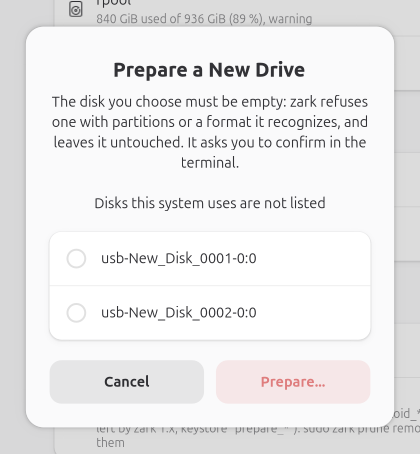
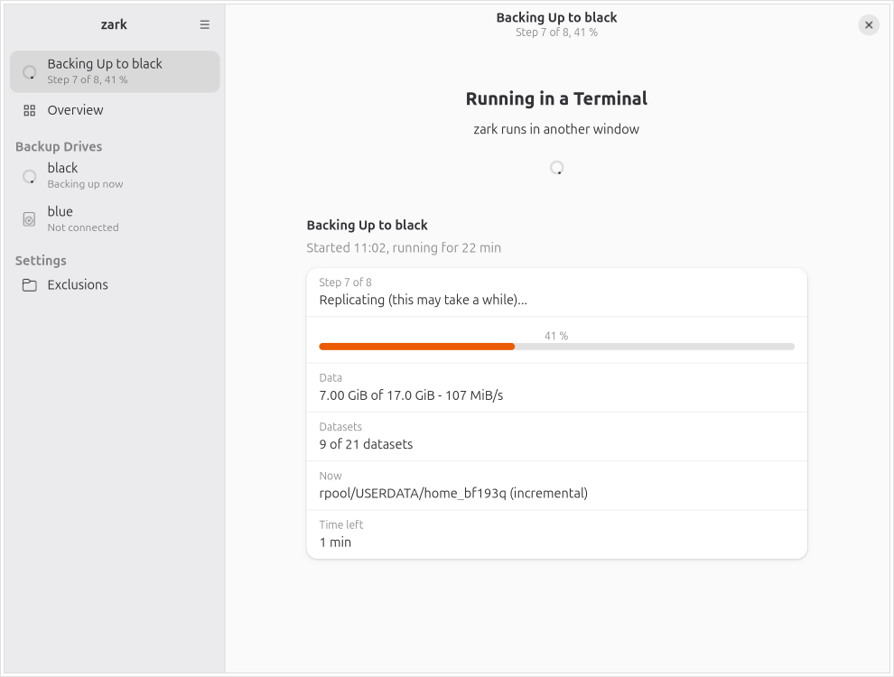
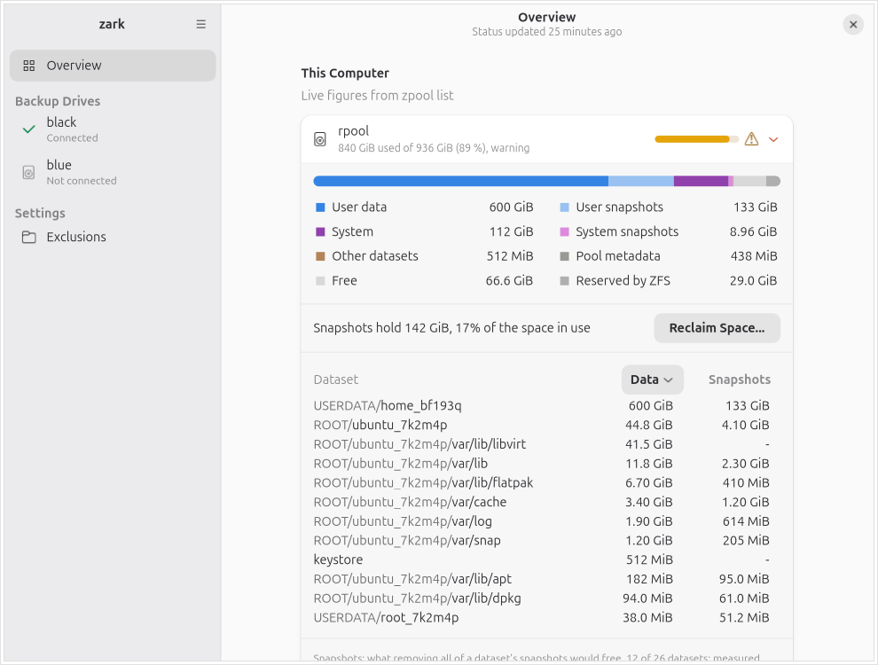
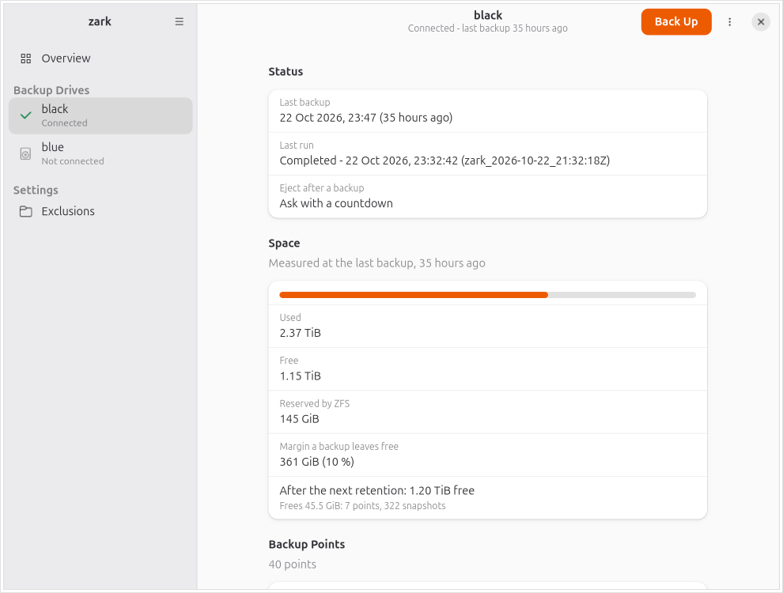
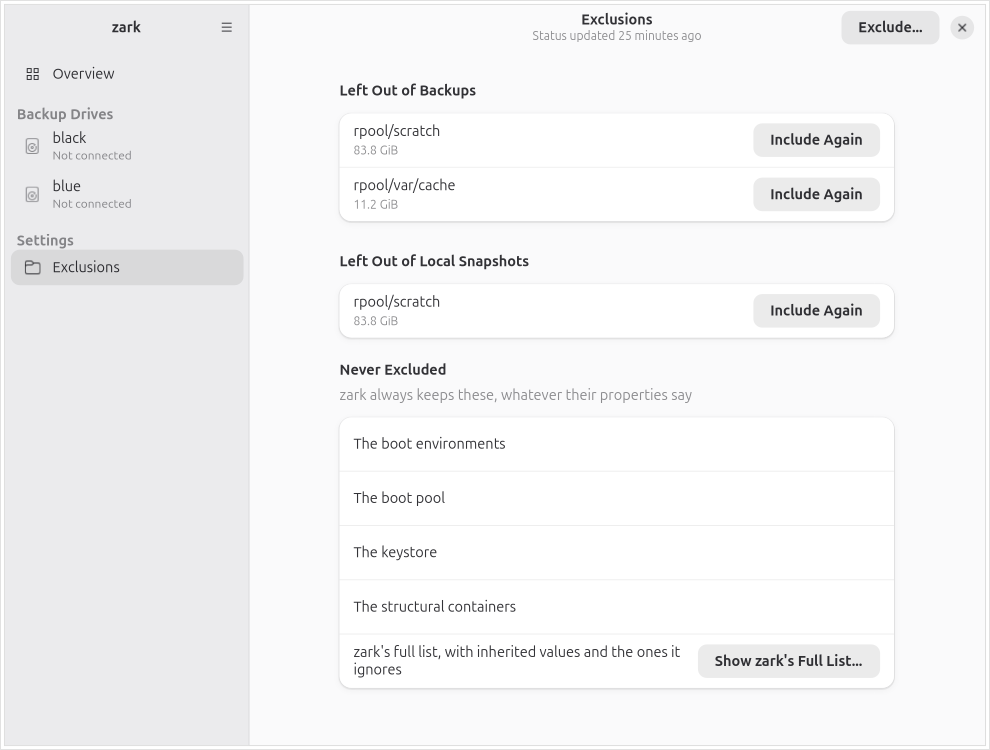
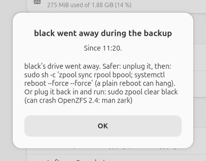
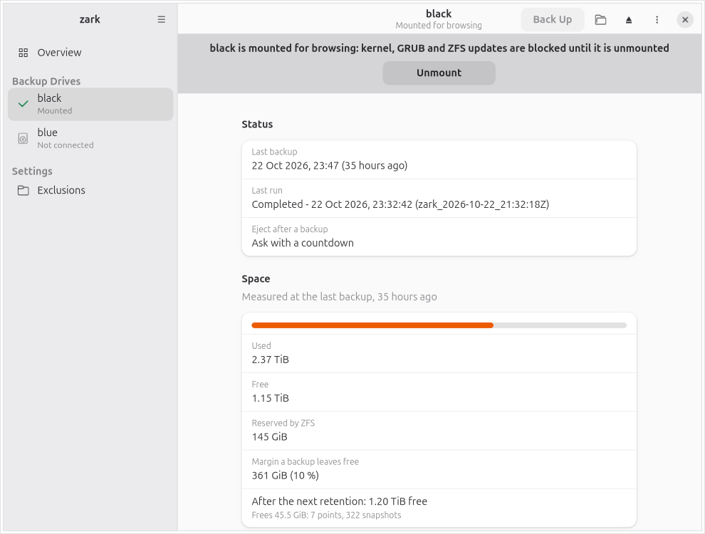

# zark user guide

How to keep an Ubuntu system on encrypted ZFS backed up with zark, and how to get it back when its disk dies, using the zark for GNOME app, the GNOME Shell extension and the terminal where they are still needed.

This guide walks through each task once. Every command, option and message is described in full in the [usage notes](USAGE.md), the [retention notes](RETENTION.md), the [upgrade notes](UPGRADING.md) and `man zark`; the guide links to them instead of repeating them.

It describes zark 2.3.3, zark for GNOME 1.2.0 and the zark backup status extension 1.4.

## Contents

1. [What zark does and what it needs](#what-zark-does-and-what-it-needs)
2. [Installing](#installing)
3. [Preparing a backup drive](#preparing-a-backup-drive)
4. [Backing up](#backing-up)
5. [Checking a drive, and a drive that goes away](#checking-a-drive-and-a-drive-that-goes-away)
6. [Browsing a backup and restoring files](#browsing-a-backup-and-restoring-files)
7. [Recovering the whole system](#recovering-the-whole-system)
8. [Upgrading, and reporting problems](#upgrading-and-reporting-problems)

## Before you start

zark erases disks: a backup drive when it is erased (`zark purge`), and the new internal disk when the system is recovered. Preparing a drive writes a new pool over an empty drive. A wrong choice of disk loses what is on it. Read [What zark touches](../README.md#what-zark-touches) once, and keep at least one other backup that zark does not manage.

The app and the extension show their own texts in your desktop's language when they have a translation for it. What zark itself writes stays in English in every language: its questions and messages in the app's terminal, and its advice in the dialog shown when a drive goes away during a backup.

## What zark does and what it needs

zark copies the whole system to an external drive, encrypted as it is, and adds a restore point each time. When the internal disk dies, it rebuilds the system on a new disk from an Ubuntu live USB, still encrypted, and the system boots with Secure Boot on.

It needs:

- **Ubuntu as its installer lays out encrypted ZFS**, with Secure Boot on: Ubuntu 24.04 LTS or 26.04 LTS (the pools rpool and bpool, and the keystore), or Ubuntu 26.10 (rpool and the keystore, with `/boot` on ext4). A system laid out by hand is not supported.
- **A USB drive** for the backups. zark uses the whole drive. A second drive lets you keep one away from the computer.
- **An Ubuntu live USB**, 26.04 or newer, for the day you recover.

On the desktop:

| | Ubuntu 24.04 | Ubuntu 26.04 | Ubuntu 26.10 |
|---|---|---|---|
| zark (terminal) | yes | yes | yes |
| zark for GNOME (app) | yes | yes | yes |
| zark backup status (GNOME Shell extension) | no | yes | yes |

The app shows how the backups stand and runs zark's operations. The extension shows the same in the top bar, notifies, and never starts or changes anything. On Ubuntu 24.04, whose GNOME Shell is too old for the extension, `zark monitor` in a terminal shows what the extension would.

## Installing

### zark, the app and the extension

All three come from the same PPA. In a terminal:

```bash
sudo add-apt-repository ppa:juanmitaboada/zark
sudo apt update
sudo apt install zark-gnome-app
```

`zark-gnome-app` brings zark with it. On Ubuntu 26.04 and 26.10, add the extension:

```bash
sudo apt install gnome-shell-extension-zark
```

and turn it on in the Extensions app.

Machines without the PPA can install zark from the `.deb` attached to each [release](https://github.com/juanmitaboada/zark/releases/latest); see [Installation](../README.md#installation).

### Setting zark up

Once per system, in a terminal:

```bash
sudo zark setup
```

`setup` installs sanoid, which takes the system's own snapshots on a schedule, and the guards that keep kernel and boot updates consistent while a backup drive is plugged in. It installs a login message and an hourly check that warn when a pool fills up or a backup is overdue (the app's "Turn On Hourly Checks" and "Turn Off Hourly Checks" switch these). It installs the packages it is missing, enables sanoid's timer and installs the guards and the alerts without asking, and asks before these changes:

- whether to write its snapshot policy to `/etc/sanoid/sanoid.conf`, and, when there are no sanoid snapshots yet, whether to take the first ones now;
- when rpool's `bookmark_v2` feature is disabled, whether to enable it (it cannot be undone; Enter answers no, and then backups and drive preparation refuse until it is enabled);
- on Ubuntu 26.10, whether to create `rpool/ROOT/<be>/zark-boot`, a copy of `/boot` inside rpool that every backup refreshes, so that each restore point holds the system and its `/boot` together. Backups and drive preparation refuse until it exists;
- only when Ubuntu's signed shim or GRUB is left on its older variant, whether to switch to the newer one (default no).

It ends with SETUP COMPLETE.

### The recovery stick

A live session has no zark installed, and you cannot add the PPA to it in a way that lasts. Download the portable tarball, `zark_<version>.tar.gz`, from the [latest release](https://github.com/juanmitaboada/zark/releases/latest). Keep it on a USB stick as it is. In the live session, extract it into `/tmp`, which is in memory there, and run zark from it (step 3 of [Recovering the whole system](#recovering-the-whole-system)). Do not extract it on the stick: on a FAT stick, as most are, the desktop mounts it with no execute bit for its files, and `./zark` does not run there. Replace the tarball when you upgrade zark.

## Preparing a backup drive

A backup drive is prepared once: zark creates a pool on it, sends the first backup point, reads it back from the drive and only then registers the drive. After that, connecting it is enough for a backup.

**zark takes only an empty drive.** It refuses a drive that has partitions or a file system signature, and says how to wipe it. Before you prepare a drive, make sure nothing on it is needed: preparing writes over the whole drive.

1. Plug in the drive.
2. In the app, open the main menu and choose **Prepare a New Drive...** (with no drive registered yet, the window shows the same button).
3. Pick the disk from the list and choose **Prepare...**. The dialog says: "The disk you choose must be empty: zark refuses one with partitions or a format it recognizes, and leaves it untouched." The list holds the whole disks that are not a registered backup drive, empty or not. Disks the system uses are left out, and the dialog says so; if it could not check them, it says that zark checks again before it writes. These lines stay in English in every language. On a desktop in another language, a caption in that language below them adds that zark cannot see every kind of data, and asks you to check the disk's name and size first. Do so in any language: zark writes over data it does not recognise.
4. GNOME asks for the administrator's password. For preparing, erasing and health checks it asks every time.
5. zark runs in the terminal inside the window. It shows the disk's model, size and transport, checks the USB bridge for known risks (and asks whether to go on when it finds one), and asks:
   - the pool's name (`backup` by default; the guide's examples use `black` and `blue`);
   - whether to eject the drive by itself after each backup (a 10-second countdown);
   - how many days the drive keeps every backup (30 by default; after that, one per month), and after how many days it keeps nothing (`off` by default: monthly points never expire). Retention is explained in [Retention on the drive](RETENTION.md#retention-on-the-drive);
   - to confirm, before it writes anything.
6. It creates the pool, sends the first backup point, sends the keystore, exports the pool, reads it back and registers the drive. The first send copies everything and takes the longest. It ends DRIVE PREPARED. If the first send or the keystore did not land, it ends DRIVE NOT REGISTERED and gives the `purge` command to wipe the drive before you prepare it again. If the read-back failed, it ends DRIVE NOT VERIFIED with what the read-back found; the drive is not registered either.



The drive's pool is not encrypted by a key of its own: the datasets on it are rpool's, sent raw, so they stay encrypted with the system's own passphrase. Keep that passphrase: you need it to recover.

**Erasing a drive.** `zark purge` wipes a drive, and it cannot be undone. A registered backup drive is erased from its menu in the app, **Erase Drive...**, which runs `zark purge` on it with the confirmations below. When a new drive has partitions, zark stops with `Drive is NOT empty` and names `zark purge`; such a drive, which zark does not know, is wiped from a terminal:

```bash
ls -l /dev/disk/by-id/
sudo zark purge /dev/disk/by-id/<disk>
```

`ls` lists every disk, internal ones too. A USB drive's name usually starts with `usb-` (`ata-` behind some USB bridges); `<disk>` is the whole-disk name, the one without `-part`, and the name its link points to (`sdb`, for example) is the kernel name `purge` asks for later. `purge` refuses a disk the system uses. Before any question it prints the disk's model, size and transport, and the pool on it if there is one: check them against the drive you mean to wipe. It asks before it wipes a drive zark does not know, then asks you to type `yes` and then the disk's kernel name. Then prepare it from the app, or with `sudo zark prepare /dev/disk/by-id/<disk>`.

**DRIVE NOT VERIFIED YET.** zark does not read a drive back while apt is installing or upgrading packages. If apt ran through the end of preparation, the drive keeps its first backup but waits to be registered: the app lists it as "Not read back yet". Once apt has finished, with the drive still plugged in, open its page and choose **Finish Registration...** (in a terminal: `sudo zark registry verify <name>`). Its next backup is incremental.

## Backing up

### Running a backup

1. Plug in the drive. The extension notifies a registered backup drive plugged in, with its last backup.
2. In the app, select the drive in the sidebar and choose **Back Up**. GNOME asks for the administrator's password, and keeps it five minutes for that command.
3. The run page shows the step, a progress bar, the data sent, the rate and the time left, and the terminal where zark asks its questions.
4. At the end zark reads the drive back. Only a backup that was read back ends BACKUP COMPLETED. Then zark asks whether to eject the drive; after an eject it says the drive is safe to unplug.

In a terminal the same backup is:

```bash
sudo zark backup
```

with `--drive <name>` when more than one backup drive is plugged in. `zark monitor`, in another terminal and without `sudo`, follows it.



While the app's own command runs, it holds logout and suspend: a Suspend from GNOME's menu asks for the administrator's password first. Closing a laptop's lid still suspends.

A backup that does not end BACKUP COMPLETED tells you what happened:

- **BACKUP NOT VERIFIED**: the data was sent but the drive was not read back, or the read-back found a problem. Do not rely on that backup; the message says what to do, and the next backup reads the drive back.
- **BACKUP INCOMPLETE**: some datasets did not reach the point; the message names them.

Each case is described under [Back up your system](USAGE.md#back-up-your-system).

### Reading the state

The app's Overview shows each system pool: how full it is, what takes its space, its largest datasets and those with the most in snapshots, and **Reclaim Space...** to free some. It also lists each backup drive with its last backup, and zark's notices. A drive's page shows its status, its last run, its space, its backup points by month and its retention.




The extension's icon in the top bar:

| Icon | State |
|---|---|
| white | backups up to date |
| orange z, the ring filling | a backup is running |
| blue, the z blinking | zark is waiting for an answer in its terminal |
| red | the last backup to a drive needs attention |
| yellow | a backup is overdue, the status is old or unreadable, or a run stopped answering |
| grey | no status from zark yet |

Its menu has the running backup, the pools, the drives and zark's warnings; "Show details..." opens a tab per pool and per drive. Its preferences, in the Extensions app, turn each notification on or off. The extension's [README](https://github.com/juanmitaboada/zark-gnome-extension#what-it-shows) describes all of it.

In a terminal, `sudo zark status` shows the pools' fill and each drive's backup age.

### Updates with a backup drive plugged in

zark's guards keep the boot chain consistent. While a backup drive is plugged in, apt refuses to install or upgrade a kernel, GRUB, shim or ZFS, before it changes anything: unplug the drive and run the update again. While a backup, a browse or a check runs, apt also refuses kernel removals. And zark does not start a backup while apt is running: it stops with a message naming the process; run it again once apt has finished. The details are under [Back up your system](USAGE.md#back-up-your-system).

### Leaving datasets out

Some data churns and need not be kept: downloads, caches, virtual machine images. The app's **Exclusions** page lists what is left out of backups and out of the local snapshots. **Exclude...** picks a dataset and whether to leave it out of backups, of local snapshots, or both; **Include Again** undoes it. zark asks in the terminal before it excludes a dataset, and says what the change means for the drives.



Only a dataset can be excluded, not a folder. Making a folder a dataset of its own is done by hand; [the downloads folder example](USAGE.md#example-a-downloads-folder-out-of-snapshots-and-backups) goes through it step by step. The boot environments, the boot pool, the keystore and the structural containers are never excluded.

### Retention and space

Each drive keeps every backup point of its window and, before that, the newest point of each month. A drive's menu has **Retention...** to change the window, the maximum age and the margin of free space a backup leaves. When a backup would leave less than the margin free, zark lists the oldest monthly points and removes them only if you say yes.

**Reclaim Space...** runs `zark prune`, which asks in the terminal whether to look at the system or a drive, shows what each kind of snapshot holds, in the system or on a drive, and removes what you choose. The details are in [Retention on the drive](RETENTION.md#retention-on-the-drive) and [Reclaiming space and alerts](RETENTION.md#reclaiming-space-and-alerts).

## Checking a drive, and a drive that goes away

### Checking a drive

A backup is read back at its end, but a drive that sits in a drawer can still decay. **Verify Drive...**, in the drive's menu, runs `zark fullcheck`, which checks the drive without changing its data:

- the restore check asks for a backup point (the newest complete one by default) and the passphrase, and reads every file `recover` would restore from it;
- the scrub has ZFS read every block on the drive and verify its checksum. On a large drive it runs for hours: roughly 4-5 hours for 1.8 TB on a 2.5" disk behind USB 3.

The passphrase is asked in the first minutes; then the check runs unattended. Ctrl+C pauses the scrub, and the next check resumes it. It ends FULL CHECK PASSED, FOUND DAMAGE or NOT FINISHED, and the drive's page shows the last check. The drive must not be mounted for browsing when the check starts. With more than one backup drive plugged in, zark asks in the terminal which one to check, whichever you selected in the app. The details are under [Check a backup drive](USAGE.md#check-a-backup-drive).

**Check Health...** runs `zark health`: choose its read-only check, which looks at the drive's USB bridge and connection for known risks and writes nothing. Its other mode, a write test, erases the drive and needs a blank one. Some USB-SATA bridges acknowledge writes they have not stored; [Safe USB disconnect](SAFE-DISCONNECT.md) and the [hardware notes](HARDWARE.md) explain why that matters.

### A drive that goes away during a backup

Do not unplug a backup drive while a backup runs. If it goes away anyway (unplugged, or a USB link that drops), `zark backup`, which watches the drive while its pool is imported, says so and gives two ways out:

1. **First:** unplug the drive and reboot at once with the command zark prints. It syncs the system's healthy pools, then runs `systemctl reboot --force --force`: a plain reboot can hang on a suspended pool. The forced reboot closes nothing and stops no service: save open work first, and do not run it while apt or dpkg is running (zark says when one is).
2. **Second:** plug the drive back in and run `sudo zpool clear <pool>`. On OpenZFS 2.4, a `zpool clear` of a pool whose drive went away with writes in flight can crash the ZFS module ([OpenZFS #18394](https://github.com/openzfs/zfs/issues/18394)): writes to the pool then hang, and the reboot itself may need a power-off. zark never runs the clear itself.

A pool whose drive never returns stays imported and suspended until a reboot.

The run starts no further transfer, waits at its end for the drive to come back (Ctrl+C there leaves the pool imported) and is never marked complete. zark records it as interrupted at once, so after the forced reboot `zark status`, `zark monitor` and the desktop show it.

The app and the extension show this in a dialog, once per backup and drive: the drive, the time it went away, and zark's own advice word for word, in English, with the reboot command selectable so it can be copied. While the extension 1.3 or later is active, it shows the dialog and the app stays quiet, so you get one dialog, not two.

This path is validated on hardware on Ubuntu 26.10 with OpenZFS 2.4.4 only. The known limitations in the [CHANGELOG](../CHANGELOG.md) describe it further.



## Browsing a backup and restoring files

zark restores a whole system, but you can also take single files back from a drive.

1. Plug in the drive and select it in the app.
2. In the drive's menu, choose **Browse Files**. With more than one backup drive plugged in, zark asks in the terminal which one, whichever you selected. It asks for the mount mode: choose **Read-only** (the first choice, recommended). Read-write changes the backup.
3. It asks for the passphrase and mounts the drive's newest point under `/mnt/zark/<pool>`.
4. Choose **Open in Files**. The system's folders are there as they were at the last backup: your home is under `home/`.
5. Copy what you need to your home with Files or `cp`. zark has no command to put a file back for you.
6. Choose **Unmount** when you are done. While the drive is mounted, its other operations, the backup among them, are unavailable.



**Older points.** The mount shows the newest point. Each dataset keeps its earlier snapshots in a hidden `.zfs/snapshot/` directory at its top, one directory per snapshot (zark's backup points are named `zark_` and their time in UTC): for the system's root, `/mnt/zark/<pool>/.zfs/snapshot/`, and for the homes, `/mnt/zark/<pool>/home/.zfs/snapshot/`. Files does not show `.zfs`; type the path in its location bar (Ctrl+L), or use `ls` in a terminal.

In a terminal, the same is `sudo zark mount` and `sudo zark umount`.

## Recovering the whole system

Recovery runs from an Ubuntu live USB, with no app: everything is in a terminal. It erases the internal disk you choose and rebuilds the system on it from a backup point.

You need the live USB (Ubuntu 26.04 or newer, started in UEFI mode), the backup drive, zark's portable tarball and the system's encryption passphrase.

1. Start the computer from the live USB and choose to try Ubuntu. Connect to a network if you can: zark installs a tool the live session lacks with apt.
2. Plug in the backup drive and the stick with the tarball.
3. Open a terminal, extract the tarball from the stick into `/tmp`, which is in memory there, and run zark from it:

   ```bash
   tar xzf <the stick's folder>/zark_*.tar.gz -C /tmp
   cd /tmp/zark
   sudo ./zark recover
   ```

   The stick's folder is `/run/media/<user>/<label>` on Ubuntu 26.10 and `/media/<user>/<label>` on earlier releases; Tab completion finds it.

4. zark finds the backup drive (with more than one it asks which), asks for the passphrase and lists the restore points, marking those from incomplete runs; the default is the newest complete backup point.
5. It asks which internal disk to erase and restore to, shows what it will do, and asks you to type `YES`. Nothing is erased before that.
6. It partitions the disk, creates the pools with encryption, restores every dataset, `/boot`, the keystore and the EFI files. It ends RECOVERY COMPLETE, or RECOVERY COMPLETED WITH ERRORS with the list of what failed: read it before you reboot. Both give the next steps, and zark then asks whether to eject the backup drive. The steps around the transfer take about a minute; the rest is copying your data.
7. Remove the live USB, unplug the backup drive and reboot. Enter the passphrase at the prompt.
8. In the recovered system, in a terminal:

   ```bash
   sudo zark finish
   ```

   This is the installed zark when the restored system has the package, as `recover`'s closing message says; otherwise extract the tarball into `/tmp` again as in step 3 and run `sudo ./zark finish` from `/tmp/zark`. `finish` rebuilds the initrd of every kernel and `grub.cfg`, and checks the boot chain. It ends FINISH COMPLETE, or FINISH INCOMPLETE with what to do for each problem. It can be run again.

If the first boot stops at an emergency shell, `recover`'s closing message gives the command for it. If the system does not boot, start the live USB again, extract the tarball into `/tmp` as in step 3, and run `sudo ./zark repair-boot` from `/tmp/zark`. When the pools are intact and only the boot is broken, `sudo ./zark chroot` opens a shell inside the installed system. Before rebooting, `sudo ./zark simulate` can start the recovered disk in a virtual machine, discarding its writes. These are described under [Recover from scratch](USAGE.md#recover-from-scratch), and the known boot failures in [Troubleshooting](TROUBLESHOOTING.md).

After a recovery, back up to the drive again. A recover does not restore zark's bookmarks, so the drive continues from the snapshots it shares with the system. When you recovered from a point older than the drive's newest, the next backup asks what to do with the newer points: keep them as archived lineages, or roll the drive back (they go). See [Retention windows](RETENTION.md#retention-windows).

## Upgrading, and reporting problems

### Upgrading zark

zark, the app and the extension upgrade with the rest of the system:

```bash
sudo apt update
sudo apt upgrade
sudo zark setup
```

The package upgrade leaves zark's installed guards as they are; `setup` replaces them with the new version's. When a version changes the guards (2.3.1 and 2.3.2 did), `zark backup` and `zark monitor` say `zark's guards are out of date: run sudo zark setup` until it has run. Running it after every upgrade does no harm. Also replace the tarball on your recovery stick. What changes in each version, and the way back, is in [Upgrading zark](UPGRADING.md).

### Upgrading Ubuntu

The only release upgrade documented is from 24.04 to 26.04, tested once on one machine. In short: back up, unplug the drive, follow the steps that avoid a stop halfway, and afterwards enable zark's PPA again, which the upgrader turns off. Read [Upgrading Ubuntu from 24.04 to 26.04](UPGRADING.md#upgrading-ubuntu-from-2404-to-2604) before you start: it gives the exact commands and what to do if the upgrade stops.

### Checking this machine, and reporting problems

`sudo zark selftest` checks that this machine's ZFS, kernel and tools behave the way zark relies on, on temporary pools backed by files in `/dev/shm`; it touches no disk and no system pool, and needs 1 GiB free in `/dev/shm` and 1.5 GiB of available memory. `sudo zark selftest status` says whether the [certificates](https://juanmitaboada.github.io/zark/) shipped with zark cover your kernel and OpenZFS. `sudo zark selftest report` prints a link that opens a new GitHub issue with the report filled in; the report holds no host, pool, disk, serial or GUID, and zark sends nothing itself.

Where to go:

- self-test results from your machine: [issue #2](https://github.com/juanmitaboada/zark/issues/2) explains it; the report goes through the link `selftest report` prints (or the file it names when the link would be too long). Read the report before you send it;
- the USB-SATA bridge your backup drive uses, with what the read-only `sudo zark health` reports and whether a backup ever ended BACKUP NOT VERIFIED with it: [issue #3](https://github.com/juanmitaboada/zark/issues/3);
- anything else: a [new issue](https://github.com/juanmitaboada/zark/issues/new/choose), with the end of `/var/log/zark.log` (on a live session, `/tmp/zark/zark.log`, in memory and gone at the next boot: to keep it, copy it to the stick before rebooting with `sudo cp /tmp/zark/zark.log <the stick's folder>/`). Remove anything you do not want to publish first: drive serial numbers, pool GUIDs, host names;
- questions: [Discussions](https://github.com/juanmitaboada/zark/discussions).

The app's problems go to [zark-gnome-app's issues](https://github.com/juanmitaboada/zark-gnome-app/issues), the extension's to [zark-gnome-extension's issues](https://github.com/juanmitaboada/zark-gnome-extension/issues).
