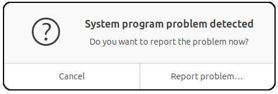

# Troubleshooting

Known problems after a recovery or on a live USB, and frequent questions.

## Troubleshooting

### "System program problem detected" popup



Symptom: while running zark from the Ubuntu live USB, a small dialog appears with a question mark icon, the title `System program problem detected`, the question `Do you want to report the problem now?`, and two buttons: `Cancel` and `Report problem...`.

Cause: this is **Apport**, Ubuntu's automatic crash-reporting agent. The popup is unrelated to zark - it's triggered when an unrelated background process on the live USB (typically `udisks2`, `systemd-udevd`, or one of the GNOME volume monitors) gets confused by the rapid disk activity zark performs (`zpool create`, `wipefs`, `sgdisk`, repeated mount/unmount cycles). Apport flags this as a system anomaly and asks the user whether to send a report to Canonical. **It does not mean zark has failed.** zark prints its own errors clearly in the terminal where you ran it, prefixed with `[FATAL]` or `[WARN]`.

What to do: the safest action is to **ignore the popup, send it to the background, and keep working in the terminal**. Don't click `Report problem...` (it tries to launch a web browser to upload the crash, which on a live USB without configured network can hang things further) and don't force-close the window (closing Apport abnormally can spawn another popup reporting Apport's own crash). The dialog is harmless - just leave it there until you finish the operation.

If the popups become distracting during a long session, you can stop Apport for the rest of the live boot:

```bash
sudo systemctl stop apport.service
```

This affects only the current live session and resets on next boot.

### "Verifying shim SBAT data failed: Security Policy Violation"

Symptom: after `zark recover`, the system fails to boot with a red screen reading `Verifying shim SBAT data failed: Security Policy Violation` and `Something has gone seriously wrong: SBAT self-check failed`.

Cause: the recovered system's `shimx64.efi` is the older `.signed.previous` variant (typically shim 15.4-0ubuntu9), which has been revoked by an SBAT level update applied to your firmware (often by `fwupd`). This usually means subiquity left the system pinned to the older variant during installation, and zark's recover faithfully reproduced that choice.

Since v1.0.7, `zark recover` proactively pins to `.latest` before reinstalling the boot binaries. If you have an older recovery that hits this, use the rescue procedure below.

**Rescue procedure:**

1. Boot the live USB of Ubuntu and **temporarily disable Secure Boot** in the firmware setup screen.
2. Boot the recovered system normally.
3. Switch to the latest signed binaries and reinstall them to the ESP:
   ```bash
   sudo update-alternatives --set shimx64.efi.signed /usr/lib/shim/shimx64.efi.signed.latest
   sudo update-alternatives --set grubx64.efi.signed /usr/lib/grub/x86_64-efi-signed/grubx64.efi.signed.latest
   sudo dpkg-reconfigure -f noninteractive shim-signed
   sudo dpkg-reconfigure -f noninteractive grub-efi-amd64-signed
   sudo update-grub
   ```
4. Re-enable Secure Boot in firmware and reboot. The system should now start.

After this rescue, your sanoid snapshots include the corrected boot chain - the next `zark backup` will be clean.

To detect and fix the same issue on your live system before it's too late, run `zark setup`. Step 5 of setup now inspects the alternatives and offers (with confirmation) to switch them.

### "disk hdN,gptN not found" / "you need to load the kernel first" after cross-host recovery

Symptom: after `zark recover`, the GRUB menu appears and lets you select a kernel, but selecting any entry produces:

```
error: no such device: <16-hex-uuid>.
error: disk 'hd2,gpt2' not found.
error: you need to load the kernel first.
```

Cause: the source machine's bpool UUID was not fully rewritten in `grub.cfg` during recovery. Pre-1.0.7 versions of zark only rewrote the simple `search --fs-uuid --set=root <UUID>` form and silently skipped the standard Ubuntu form (`search --fs-uuid --set=root --hint-bios=hd2,gpt2 --hint-efi=hd2,gpt2 --hint-baremetal=ahci2,gpt2  <UUID>`), which is the only one that actually runs on grub 2.12+. The bug stayed hidden whenever the recovered disk happened to land at the same BIOS index as the original (typically when re-recovering the same physical machine), but surfaces immediately on **cross-host recovery** where the new drive enumeration differs.

This is fixed in v1.0.7. If you have an older recovery hitting it, the simplest path is to re-run `zark recover` with v1.0.7+. As an alternative without a fresh recover, boot from the live USB and:

```bash
sudo ./zark repair-boot
```

`repair-boot` regenerates `grub.cfg` from inside the recovered system, which produces UUIDs and hints matching the current firmware layout.

## FAQ

**Can I use multiple backup drives?**

Yes. Register additional drives in `etc/known_drives.json` with their GUID. zark will detect whichever drive is connected.

**What if recovery drops to an emergency shell?**

Run `zpool import rpool && exit`. On subsequent boots this won't happen. Alternatively, boot from the live USB and run `sudo ./zark repair-boot`.

**Does the recovered system require any custom components?**

No. The boot chain is 100% standard Ubuntu - identical to a fresh installation. The only addition is the optional GRUB guard script, which can be safely removed.
